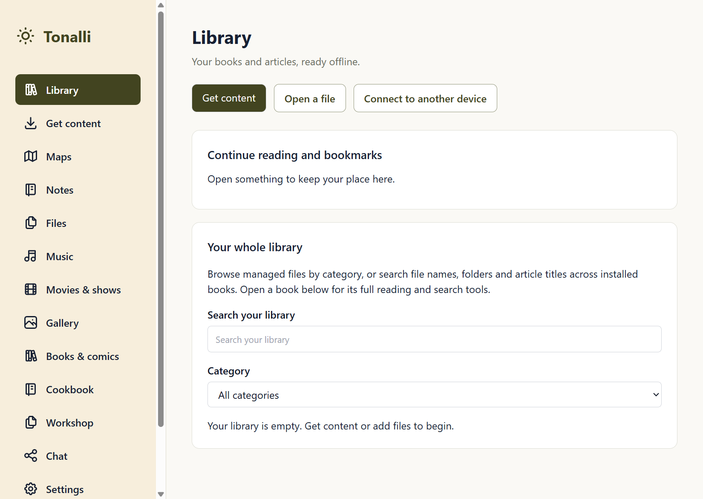

# Menu and layout

- **Windows:** a permanent sidebar on the left lists every section.
- **Android:** a menu button (three lines) at the top left opens the same list as a drawer. Scroll the
  drawer to reach Chat, Local AI and Settings.

Sections, in order: Library, Get content, Maps, Notes, Files, Music, Movies & shows, Gallery,
Books & comics, Cookbook, Workshop, Chat, Local AI, Settings. Local AI only appears in builds that
include the on-device AI.

The tagline "Knowledge, wherever you are." sits at the bottom of the Android drawer.

While reading another device's library, a banner on every page says so and links to **Connection
settings** (Settings > Sharing and devices).
