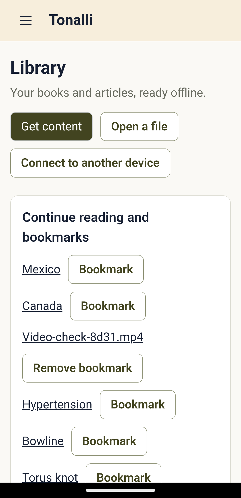
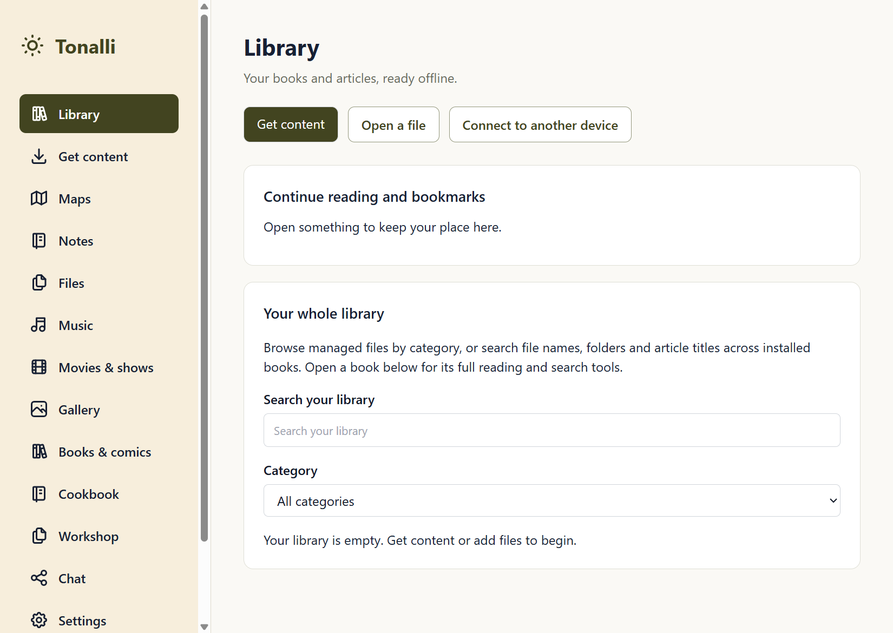

# Library

| Android | Windows (new, empty profile) |
|---|---|
|  |  |

1. Open the app. It lands on **Library** ("Your books and articles, ready offline.").
2. Three buttons start everything: **Get content**, **Open a file**, **Connect to another device**.
   The last one opens **Settings > Sharing and devices**, where the connect card is (see [05-sharing](05-sharing.md)).
3. **Continue reading and bookmarks** lists what you opened recently, with a Bookmark button on each.
   On a new install it says "Open something to keep your place here."
4. **Your whole library** searches file names, folders and article titles across everything installed.
   The **Category** menu narrows it. An empty library says "Your library is empty. Get content or add
   files to begin."
5. Installed books appear as links, for example "Knots by Wikipedia — Books".
