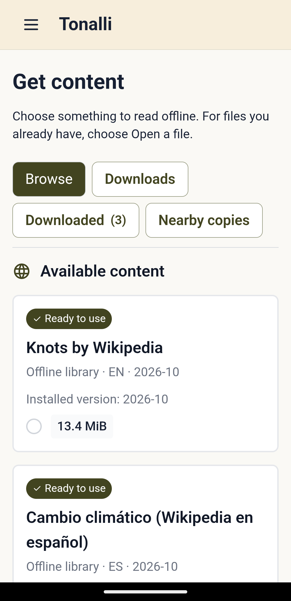
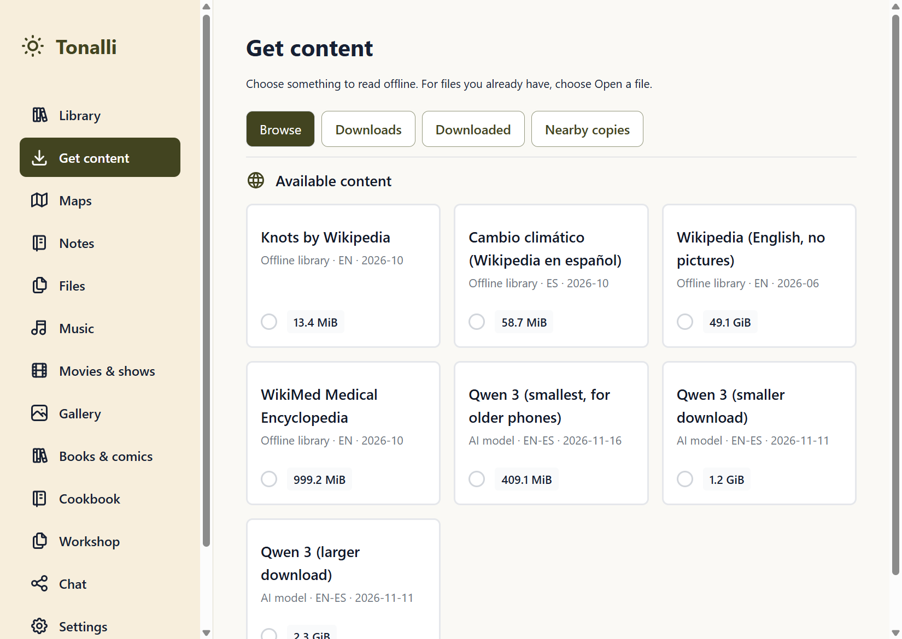
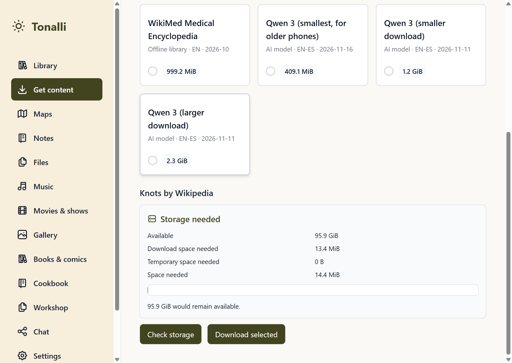
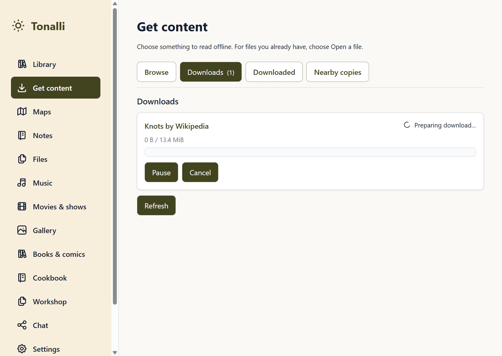
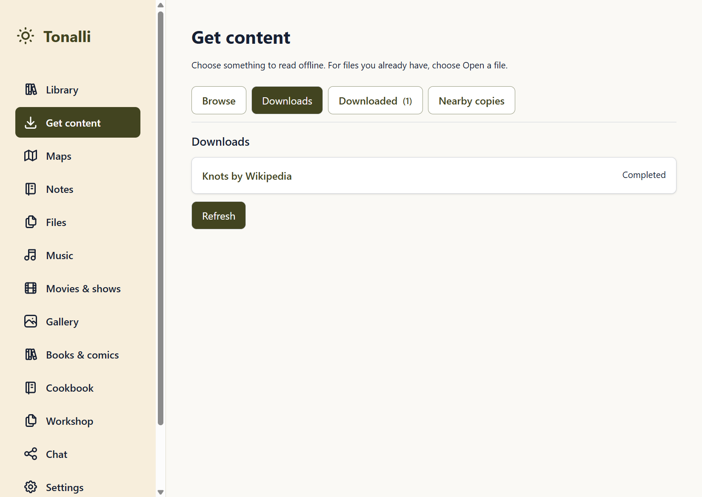
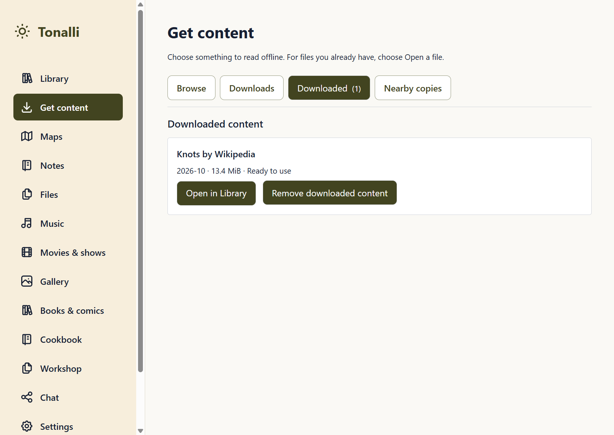
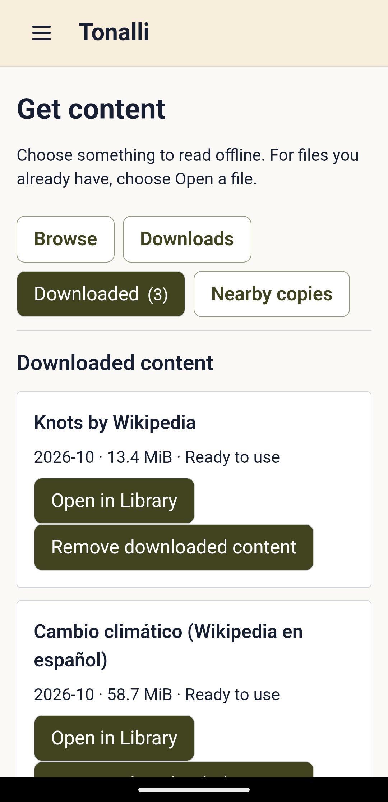

# Get content

The page is split into four tabs instead of one long scroll: **Browse**, **Downloads**, **Downloaded**
and **Nearby copies**. Numbers in brackets count active downloads and installed items.

| Android | Windows |
|---|---|
|  |  |

## Download something

1. **Browse** lists the catalog as cards: Wikipedia books, the medical encyclopedia, and AI models.
   Installed items are marked "Ready to use".
2. Click a card, for example **Knots by Wikipedia** (13.4 MiB). A **Storage needed** panel shows
   available space, download space, temporary space, and how much would remain.
   
3. Press **Download selected** (use **Check storage** first if you want to refresh the numbers).
4. The page switches to **Downloads** by itself. The card shows "Preparing download…", then progress,
   with **Pause** and **Cancel**.
   
5. When finished the card says **Completed** and the **Downloaded** tab gets a (1) badge.
   
6. **Downloaded** shows version, size and "Ready to use", with **Open in Library** and
   **Remove downloaded content** (asks to confirm).
   

Android's Downloaded tab: 

A downloaded AI model shows a link to **Settings > AI and updates** (opens that tab) instead of
**Open in Library**.

**Nearby copies** lists books saved from another Tonalli device and lets you remove them (see [05-sharing](05-sharing.md)).
