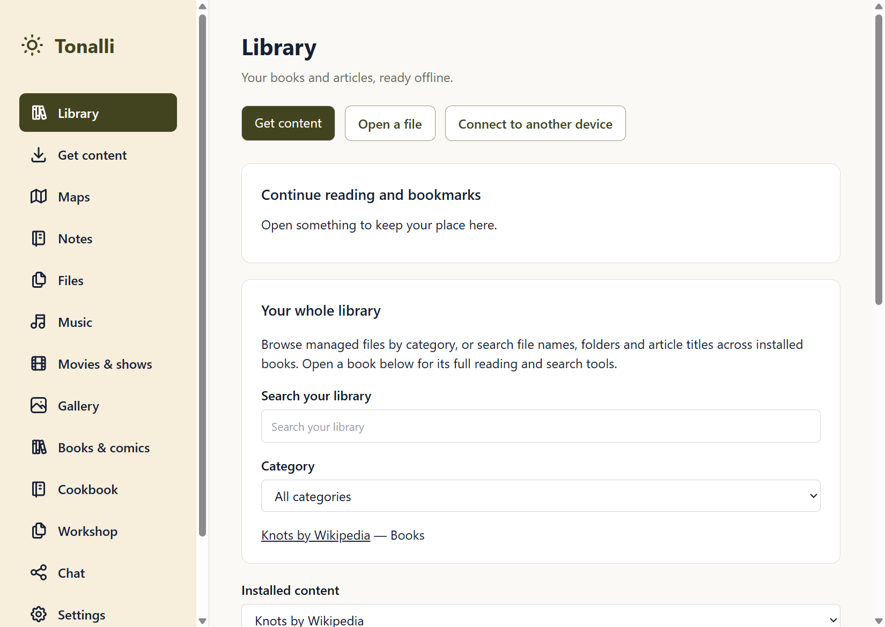
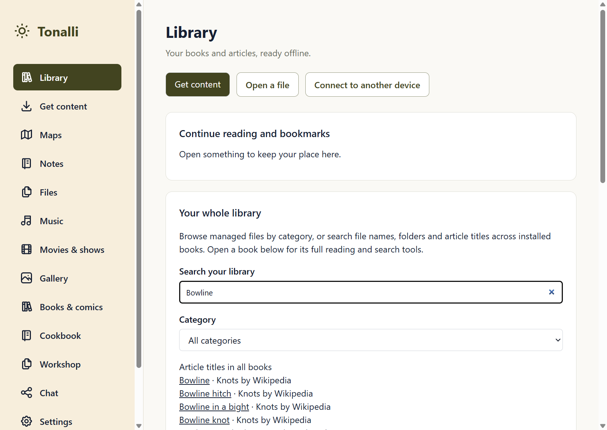
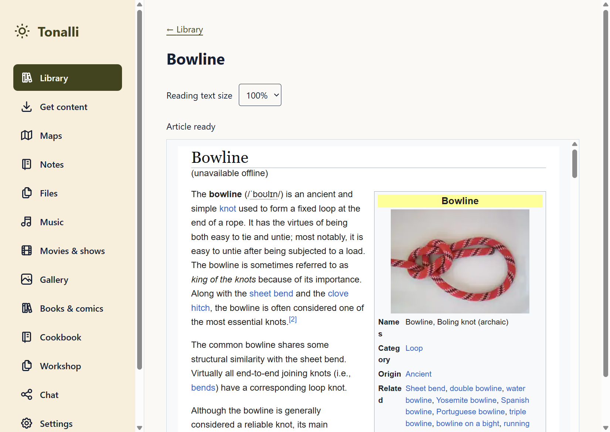
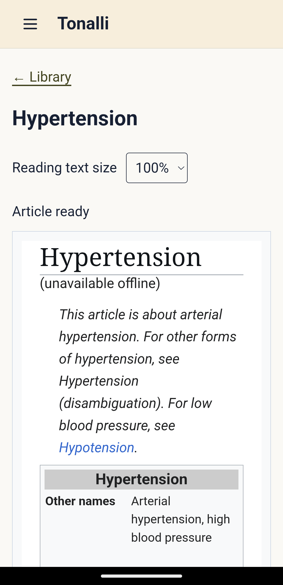

# Open a book, search, read

1. From **Get content > Downloaded**, press **Open in Library**. The Library shows the book and an
   **Installed content** picker.
   
2. Type in **Search your library**, for example "Bowline". Matching titles appear under
   "Article titles in all books" as you type.
   
3. Choose a result. The article opens with a **← Library** link, a **Reading text size** menu (100%
   by default) and the status "Article ready". Images and links inside the article work offline; links
   to things not in the book say "(unavailable offline)".
   

Same flow on Android. An article opened from the Library (the Android Library keeps your place under
**Continue reading and bookmarks**):

