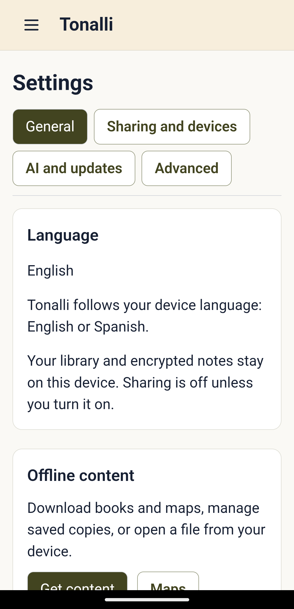
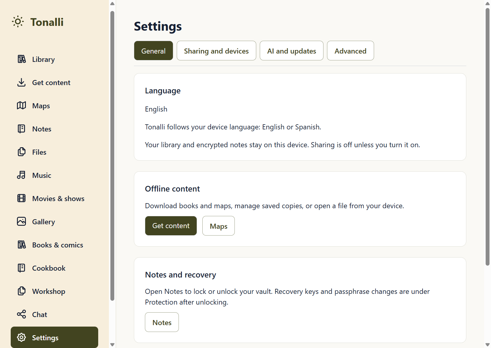

# Settings (tabs)

Settings is split into four tabs: **General**, **Sharing and devices**, **AI and updates**,
**Advanced**. On a phone the tab buttons wrap onto two lines.

| Android | Windows |
|---|---|
|  |  |

**General** holds:

1. **Language.** Tonalli follows the device language (English or Spanish). It also states that your
   library and encrypted notes stay on this device and sharing is off unless you turn it on.
2. **Offline content:** shortcuts to Get content and Maps.
3. **Notes and recovery:** a shortcut to Notes, where recovery keys and passphrase changes live.
4. **About Tonalli:** the licence line and a link to the open-source notices.

A notifications notice can also appear at the top of this tab when the system notification
permission is off.
