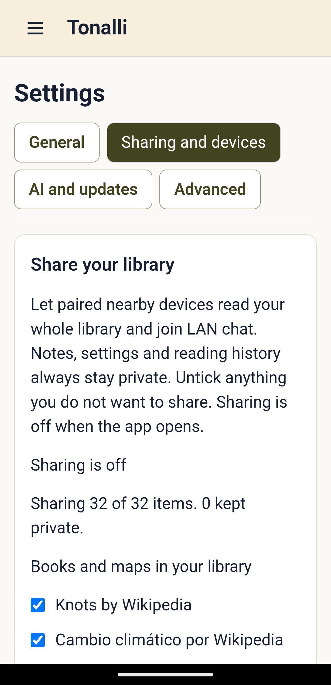
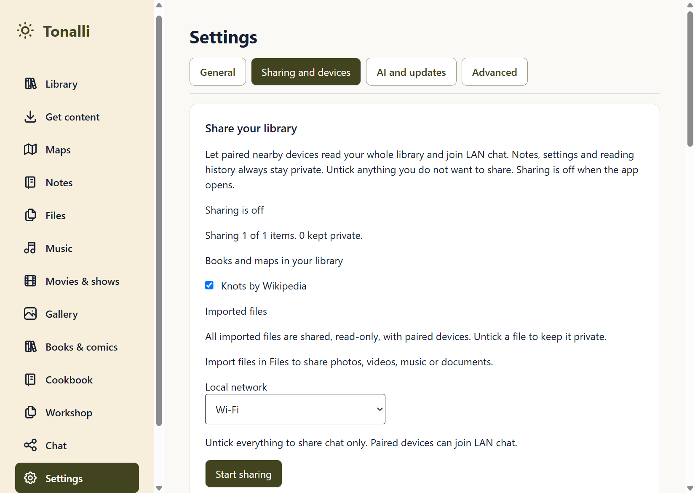
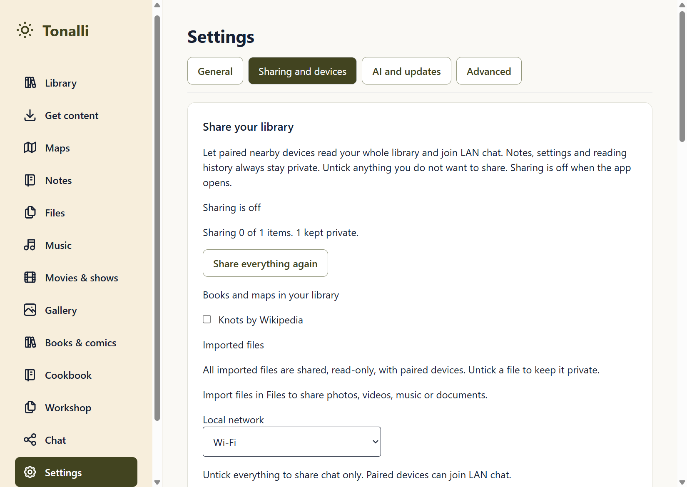

# Sharing your library

Sharing is **off** when the app opens. When you turn it on, paired nearby devices on the same local
network can read your **whole library**, read-only. Notes, settings and reading history are never
shared. You remove individual items instead of choosing them one by one.

| Android | Windows |
|---|---|
|  |  |

## Share everything, then remove what you want to keep private

1. Open **Settings > Sharing and devices**. The card is **Share your library**.
2. The status reads "Sharing is off", and a summary line counts the library:
   "Sharing 32 of 32 items. 0 kept private." (Android; Windows shows 1 of 1.)
3. **Books and maps in your library** lists every installed book and map, all ticked.
   **Imported files** lists everything imported in Files, also all ticked, 50 per page with a search box.
4. **Untick** any item to keep it private. The summary updates and a **Share everything again**
   button appears.
   
5. Pick the **Local network** if more than one is offered (Wi-Fi, or the phone hotspot on Android).
6. Press **Start sharing**. Untick everything to share chat only.

## While sharing is on

- The card shows the connect address, a QR or invitation, the **pairing code** and the certificate
  fingerprint, plus the list of connected devices with a **Disconnect** button for each.
- **Shared now** lists every book, map and file being shared, each with a **Remove** button
  :
  
  Removing
  one stops sharing it **at once** for connected devices (it disappears from their lists and its
  address returns "not found"). If everything is removed, the card says "Nothing from your library is
  shared. Paired devices can still use chat."
- Removing is one-way. To share an item again, **Stop sharing**, tick it and start again.
- On the other device, **Connect to another device** (Library) opens this tab on the connect card.
  Paste the invitation, check the fingerprint shown matches, tick the confirmation, enter the
  6-digit code and a name for the device, then **Connect to another device**. The page then reads
  "Reading a library shared by another device." with a **Connection settings** link back to this card
  and **Return to my library** to disconnect.

## Limits and behaviour to know

- Up to **1024** imported files can be shared at once. Above that, Start is disabled with a message
  asking you to untick some.
- Files are shared as copies taken when sharing starts. To include later edits, stop and start again.
- A response already being sent when you press Remove may complete; every new request for the item
  is refused.

Other cards on this tab: **Connect to another device**, **Chat connections**, and **TV sharing** where
the platform supports it.
