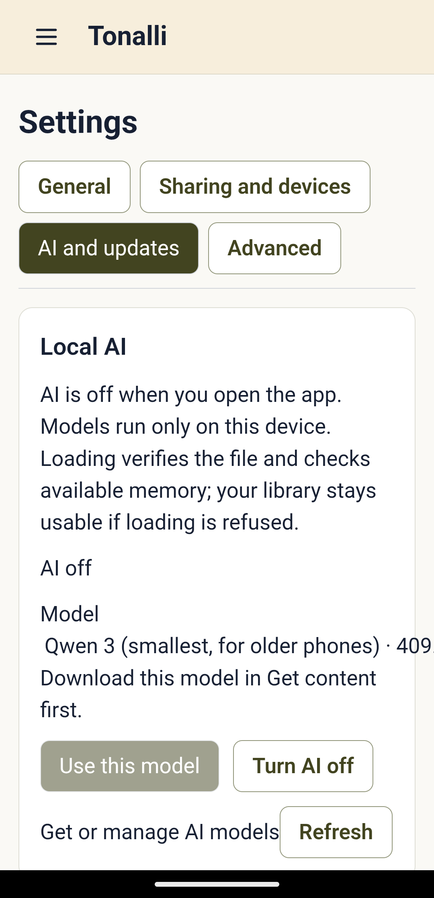
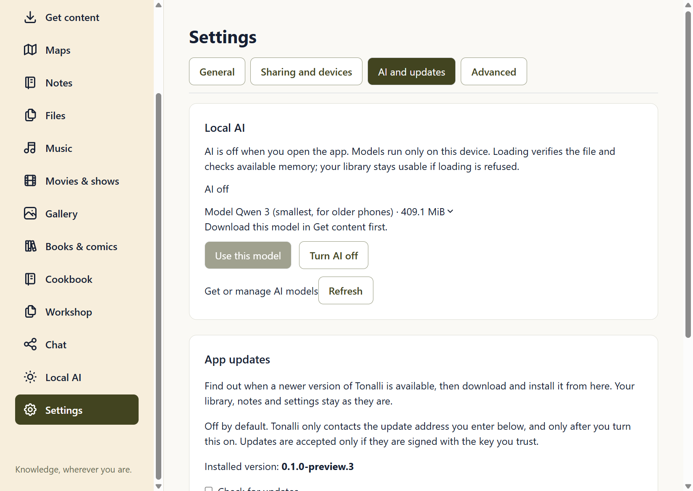

# Settings > AI and updates

| Android | Windows |
|---|---|
|  |  |

1. **Local AI** is off when the app opens. Models run only on this device. Loading a model verifies
   the file and checks available memory, and your library stays usable if loading is refused.
2. Choose a **Model** from the list (for example "Qwen 3 (smallest, for older phones) · 409.1 MiB").
   If it is not downloaded the page says "Download this model in Get content first."
3. **Use this model** loads it and **Turn AI off** unloads it. **Get or manage AI models** opens
   Get content and **Refresh** rereads the status.
4. **App updates** is **off by default**. Tonalli contacts nothing until you tick **Check for
   updates** and enter your own **Update address** (GitHub `owner/repo` or an https address) and
   the **Trusted publisher key** (64 characters).
5. Updates are accepted only if signed with the key you entered. **Save** stores the settings and
   **Check now** looks once. The installed version is shown.
6. Windows swaps the new version in place. Android hands the verified file to the system installer,
   which shows its own prompt.

Both devices show the same screen: no model is loaded ("AI off"), so **Use this model** is greyed out
until one is downloaded in Get content.
