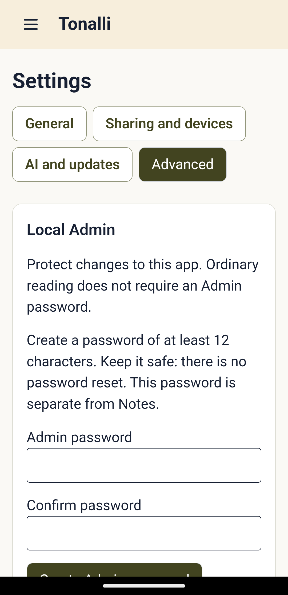
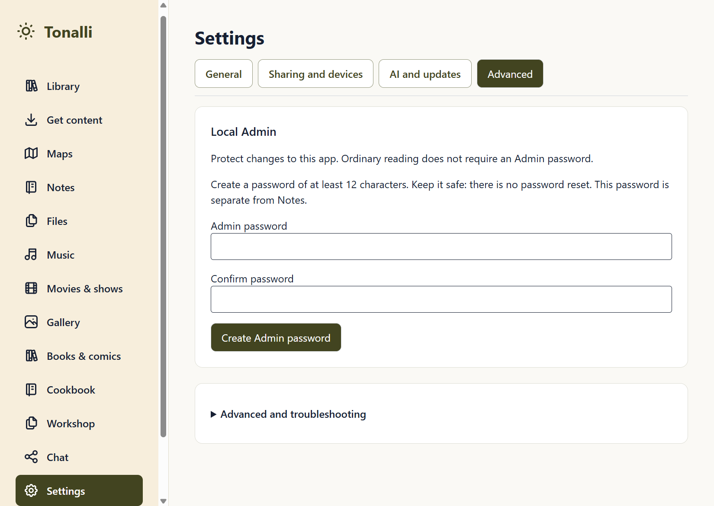

# Settings > Advanced

| Android | Windows |
|---|---|
|  |  |

1. **Local Admin** protects changes to the app. Ordinary reading never needs it.
2. Create a password of at least 12 characters (**Admin password** and **Confirm password**, then
   **Create Admin password**). There is no password reset. It is separate from the Notes passphrase.
3. Once unlocked, Admin controls appearance and which sections show (for example hiding Maps or Notes),
   and unlocks actions such as importing and removing managed files.
4. **Advanced and troubleshooting** (collapsed) holds technical options. On native builds it has a link
   to the advanced screen.
