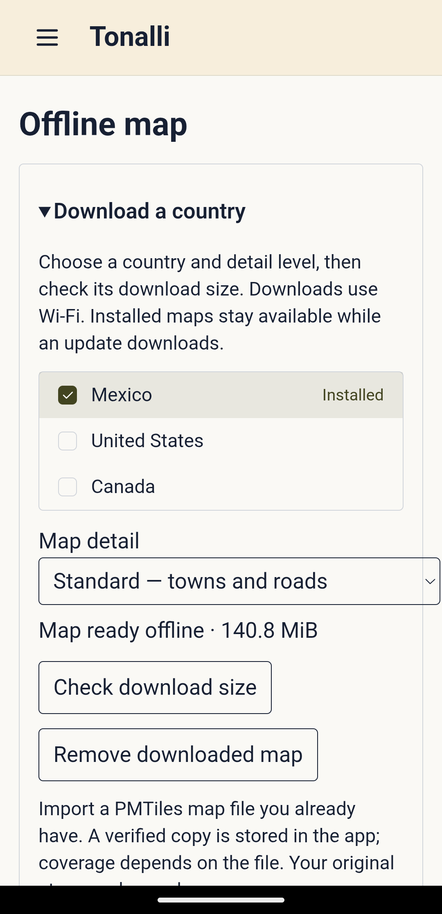
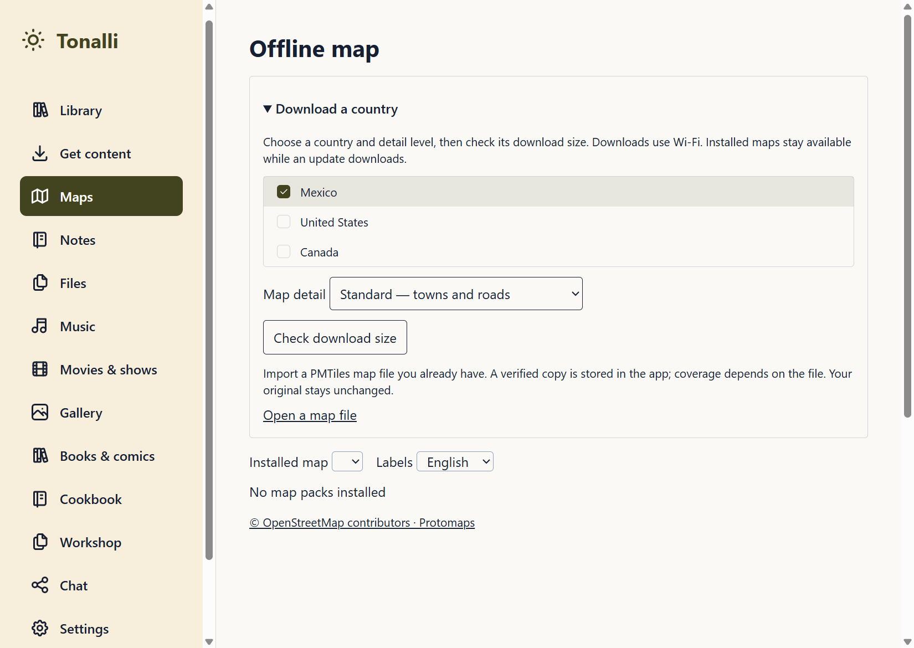

# Maps

| Android (Mexico installed) | Windows (new profile) |
|---|---|
|  |  |

1. **Offline map** opens with **Download a country** expanded: Mexico, United States, Canada.
2. Pick a country and a **Map detail** level (for example "Standard — towns and roads"), then
   **Check download size**. Downloads use Wi-Fi and installed maps stay available while an update
   downloads.
3. **Open a map file** imports a PMTiles file you already have. A verified copy is stored in the app and
   the original is untouched.
4. Under that, **Installed map** and **Labels** (English or Spanish) choose what the map shows. With
   nothing installed it says "No map packs installed".
5. The attribution line (OpenStreetMap contributors, Protomaps) stays at the bottom.

On the phone, an installed country is ticked and marked **Installed**. The page then shows
"Map ready offline" with its size (for example 140.8 MiB) and a **Remove downloaded map** button.
