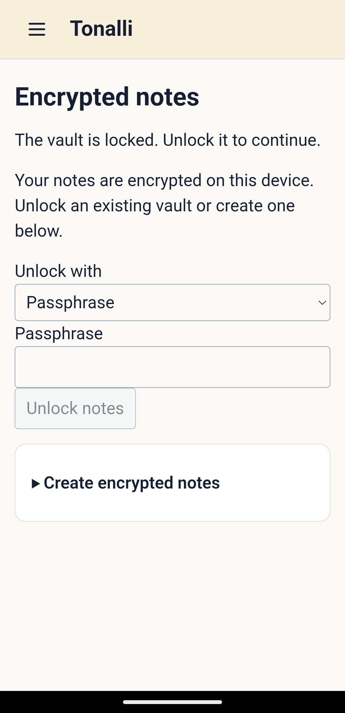
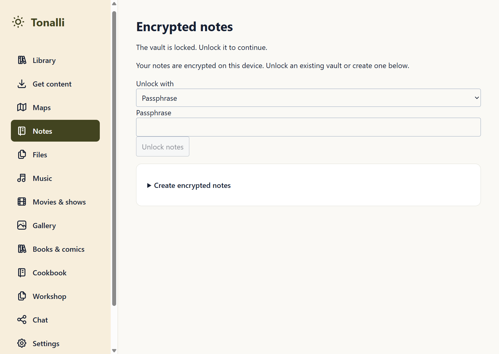

# Encrypted notes

| Android | Windows |
|---|---|
|  |  |

1. Notes are encrypted on the device. With no unlocked vault the page says "The vault is locked.
   Unlock it to continue."
2. **Unlock with** a **Passphrase** (or a recovery key), then **Unlock notes**.
3. New users open **Create encrypted notes** to set a passphrase.
4. A wrong passphrase leaves the file unchanged. Notes never fall back to plain text and are never
   shared. Recovery keys and passphrase changes are under **Protection** after unlocking.
