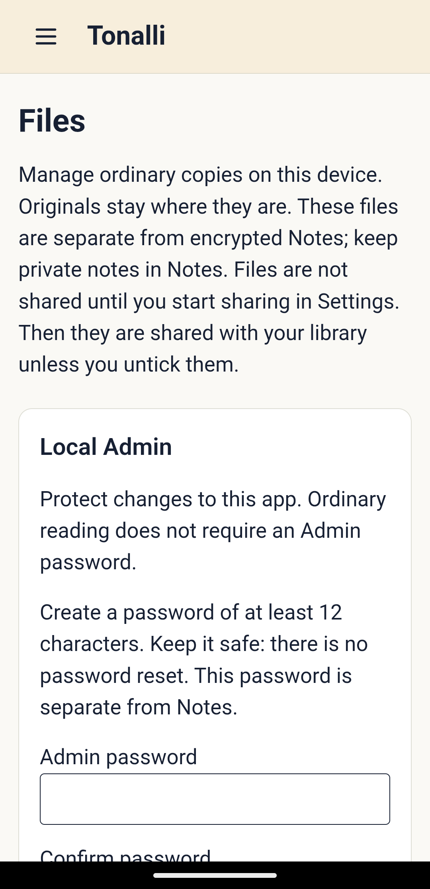
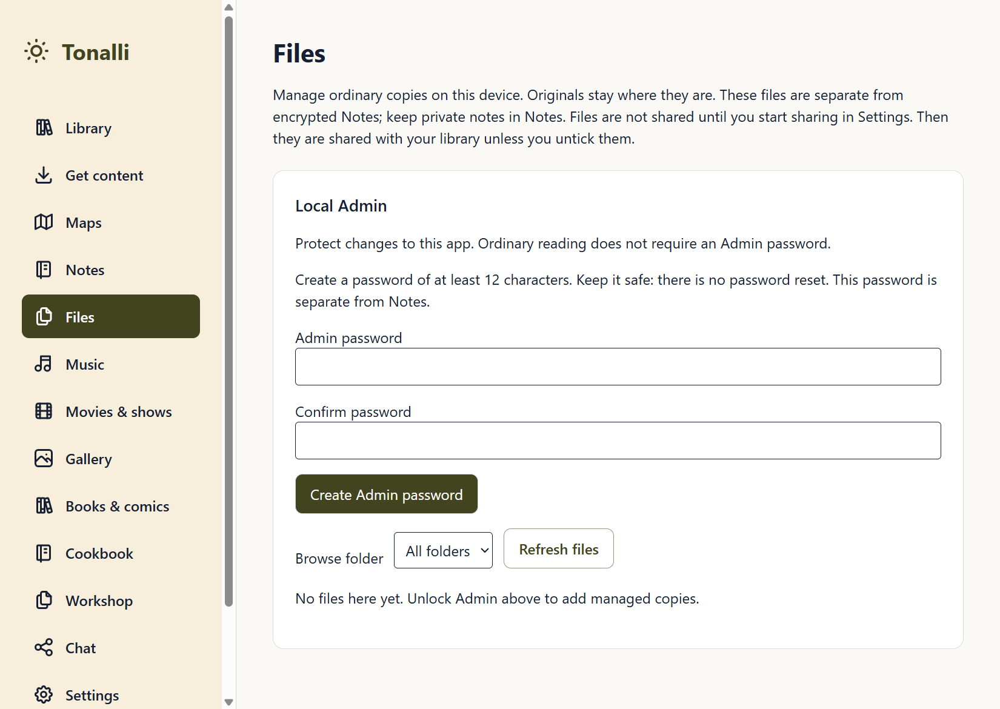

# Files

| Android (top of the page) | Windows |
|---|---|
|  |  |

1. **Files** manages ordinary copies of files on this device. Originals stay where they are, and these
   files are separate from encrypted Notes.
2. The help text says files are not shared until you start sharing in Settings, and are then shared
   with your library unless you untick them (see [05-sharing](05-sharing.md)).
3. Adding or removing managed copies needs **Local Admin** (create or unlock the password on this page).
4. **Browse folder** filters by folder and **Refresh files** reloads. A new install says "No files here
   yet. Unlock Admin above to add managed copies."
5. Imported files appear in Music, Movies & shows, Gallery, Books & comics and Workshop by type.
