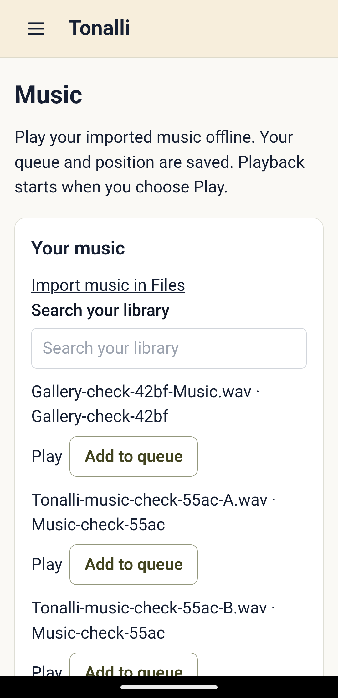
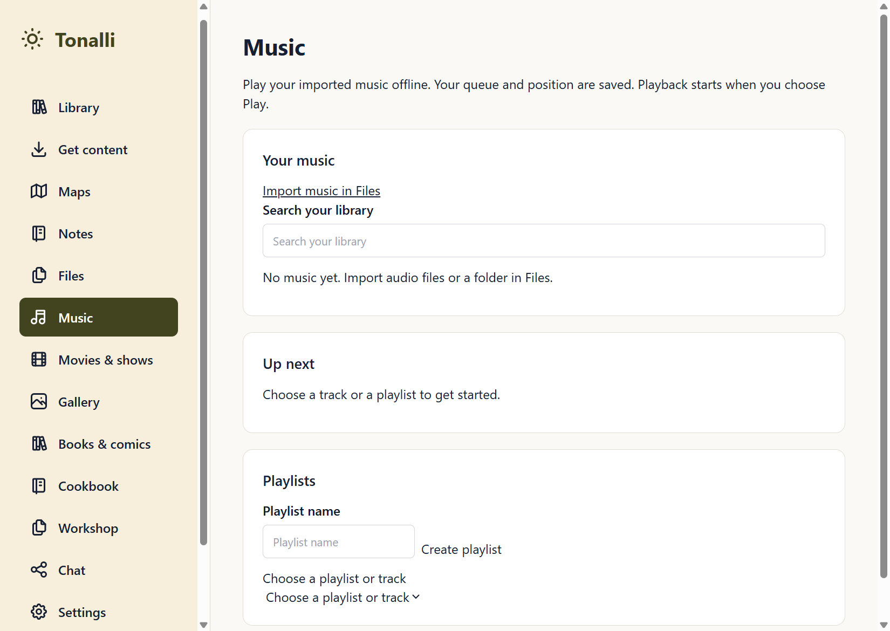

# Music

| Android (with sample tracks) | Windows (no music yet) |
|---|---|
|  |  |

1. "Play your imported music offline. Your queue and position are saved. Playback starts when you
   choose Play."
2. **Your music** lists imported audio with a search box. Each track shows its file name and folder,
   with **Play** and **Add to queue**. With none, it links to **Import music in Files**.
3. **Up next** is the queue ("Choose a track or a playlist to get started").
4. **Playlists:** name one, press **Create playlist**, then use the picker to choose a track or playlist.
