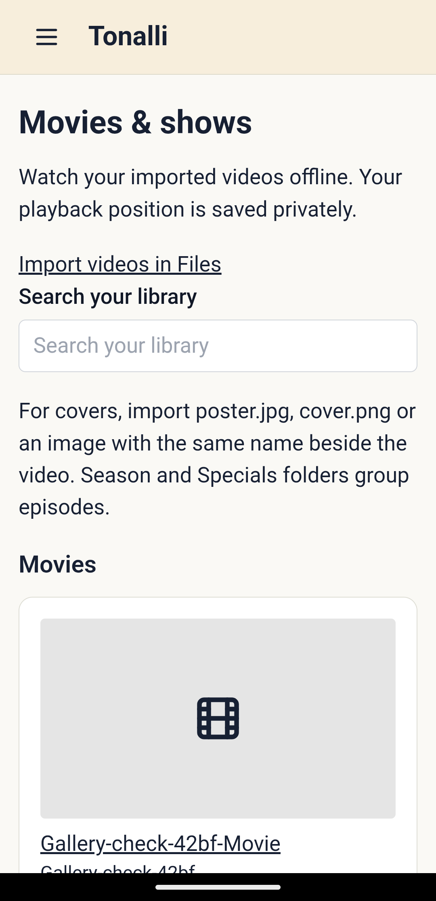
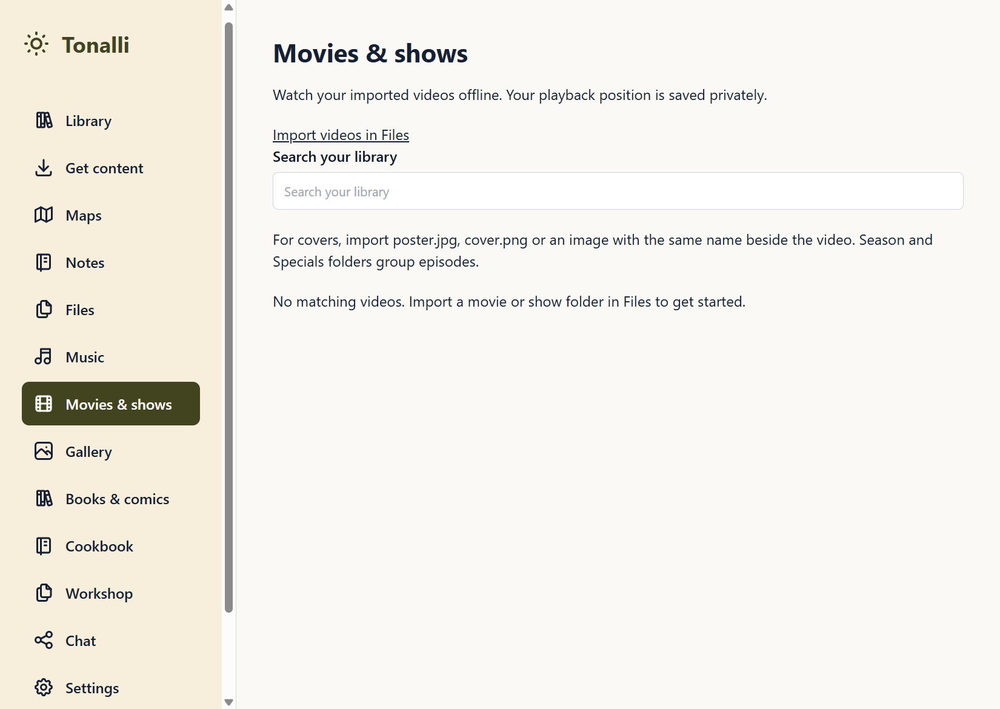

# Movies and shows

| Android (with a sample clip) | Windows (no videos yet) |
|---|---|
|  |  |

1. "Watch your imported videos offline. Your playback position is saved privately."
2. **Import videos in Files** adds videos. Search by name.
3. Covers come from a `poster.jpg`, `cover.png` or an image with the same name beside the video.
   **Season** and **Specials** folders group episodes.
4. Imported videos appear under a **Movies** heading as cards with a cover (a film icon when there
   is none) and the title as a link.
5. With no videos: "No matching videos. Import a movie or show folder in Files to get started."
