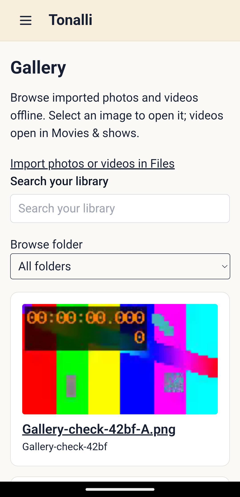
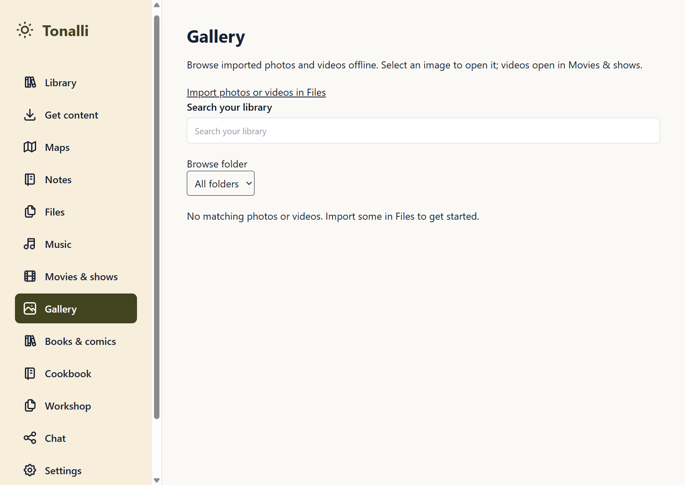

# Gallery

| Android (with a sample image) | Windows (no pictures yet) |
|---|---|
|  |  |

1. Browse imported photos and videos offline. Selecting an image opens it. Videos open in
   **Movies & shows**.
2. **Import photos or videos in Files** adds more. Search by name or choose a **Browse folder**.
3. Images show as large thumbnail cards with the file name and folder underneath.
4. With nothing imported: "No matching photos or videos. Import some in Files to get started."
