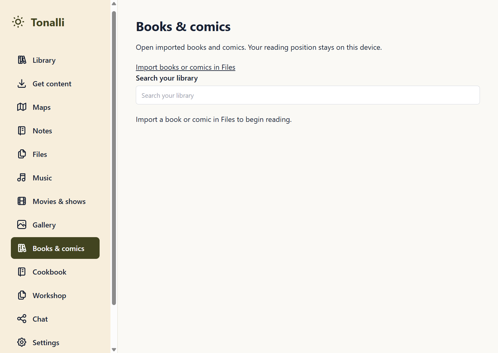

# Books and comics

| Android (empty) | Windows (empty) |
|---|---|
|  |  |

1. Open imported books and comics (EPUB, PDF and comic archives). Your reading position stays on this
   device.
2. **Import books or comics in Files** adds more, and the search box finds them by name.
3. With none: "Import a book or comic in Files to begin reading."
