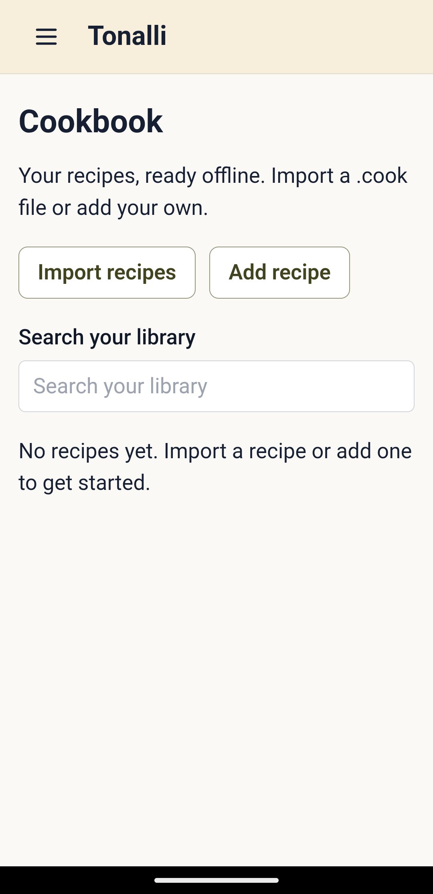
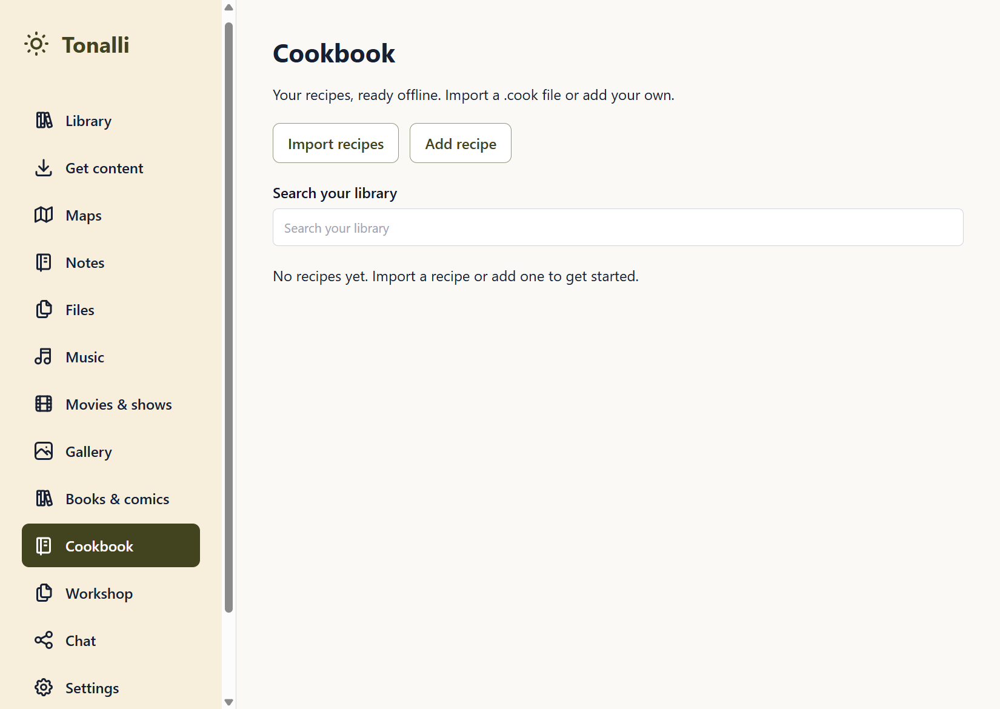

# Cookbook

| Android (empty) | Windows (empty) |
|---|---|
|  |  |

1. "Your recipes, ready offline. Import a .cook file or add your own."
2. **Import recipes** loads `.cook` files. **Add recipe** writes one by hand.
3. Search finds recipes by name. With none: "No recipes yet. Import a recipe or add one to get started."
