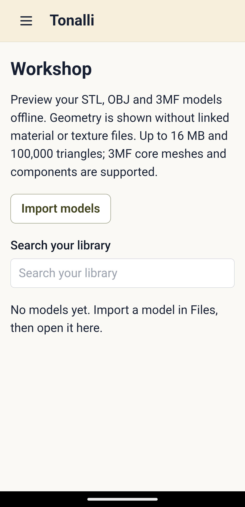
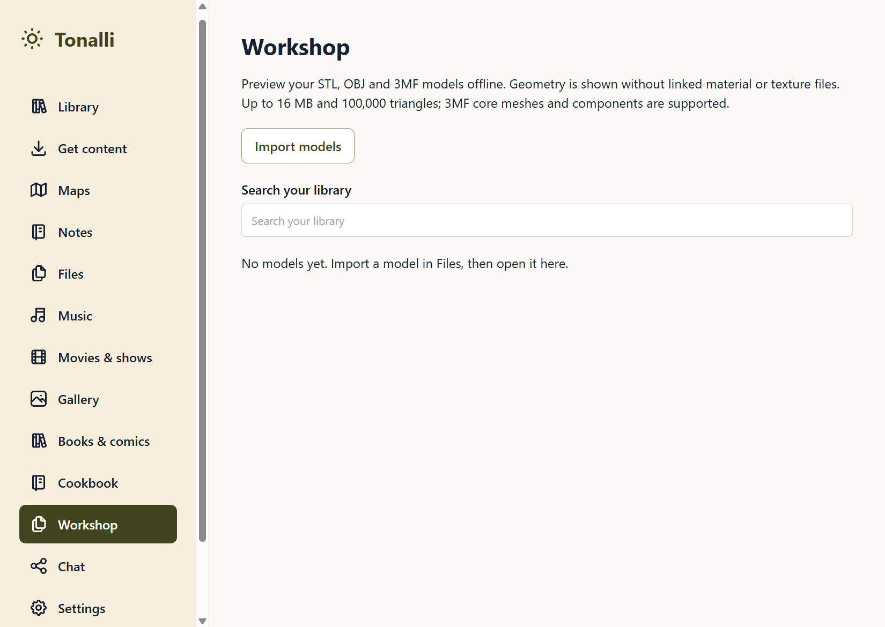

# Workshop

| Android (empty) | Windows (empty) |
|---|---|
|  |  |

1. Preview STL, OBJ and 3MF models offline. Geometry is shown without linked material or texture
   files. Limits: 16 MB and 100,000 triangles per model.
2. **Import models** adds a model, and the search box finds one by name.
3. With none: "No models yet. Import a model in Files, then open it here."
