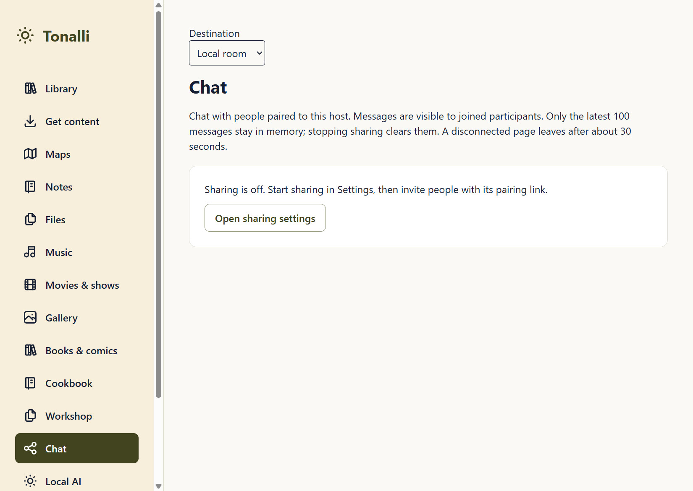

# Chat

1. Chat has a **Destination** menu that chooses where messages go. Until you set up a radio or an
   internet broker, only **Local room** is offered. Radio and internet-broker destinations are set up under
   **Settings > Sharing and devices**.
2. **Local room** chats with people paired to this device over the local network. With sharing off it
   says "Sharing is off. Start sharing in Settings, then invite people with its pairing link."
   **Open sharing settings** jumps to the Sharing tab ([05-sharing](05-sharing.md)).
3. Only the latest 100 messages stay in memory, and stopping sharing clears them.
