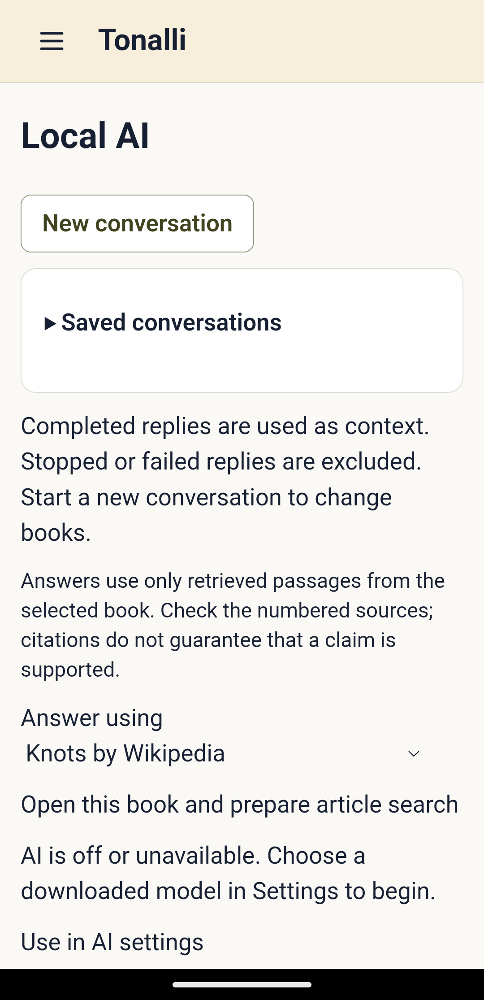
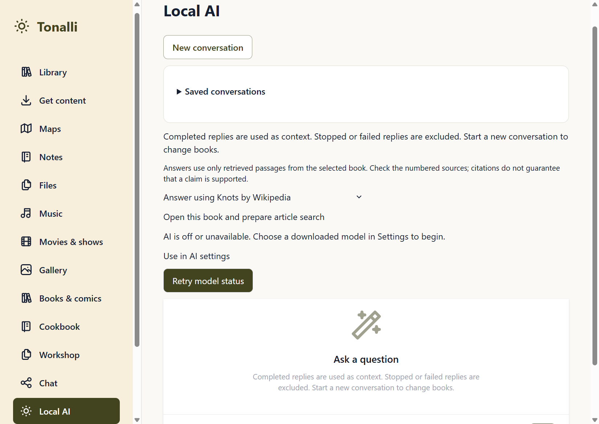

# Local AI

| Android | Windows |
|---|---|
|  |  |

No model is loaded yet in these screenshots.

1. **New conversation** starts a fresh chat. **Saved conversations** (collapsed) reopens earlier ones.
2. **Answer using** picks an installed book to ground the answers, for example "Knots by Wikipedia".
   Answers use only passages retrieved from that book, with numbered sources. Citations do not
   guarantee a claim is supported.
3. **Open this book and prepare article search** readies searching inside the book for AI answers.
4. With no model loaded the page says "AI is off or unavailable. Choose a downloaded model in Settings
   to begin." **Use in AI settings** opens **Settings > AI and updates** directly and **Retry model status**
   checks again.
5. **Ask a question** is the message box. Completed replies are used as context for the next
   question, and stopped or failed replies are left out.

To get a model: **Get content** lists Qwen 3 models (smallest 409 MiB, for older phones), then choose
and load one in [06-settings-ai-updates](06-settings-ai-updates.md).
