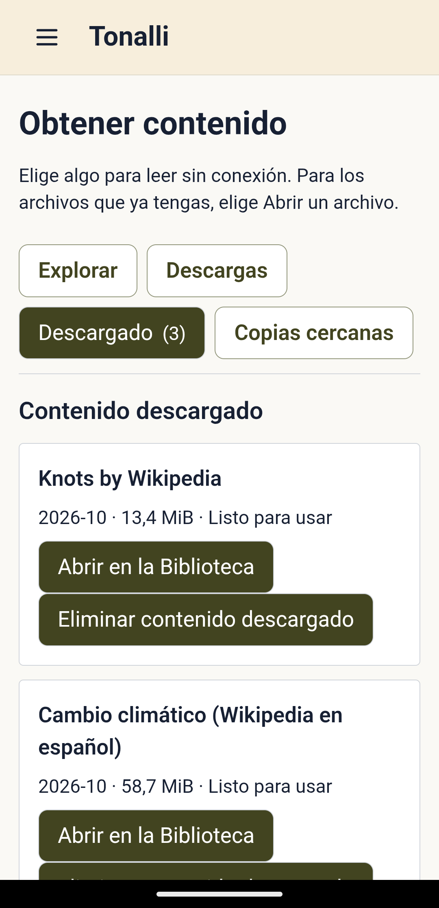
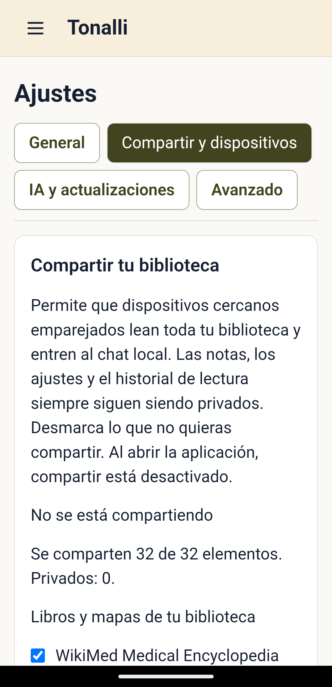
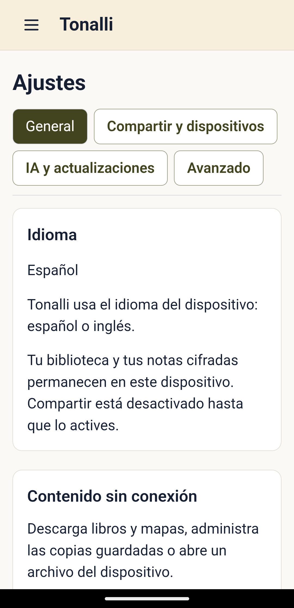
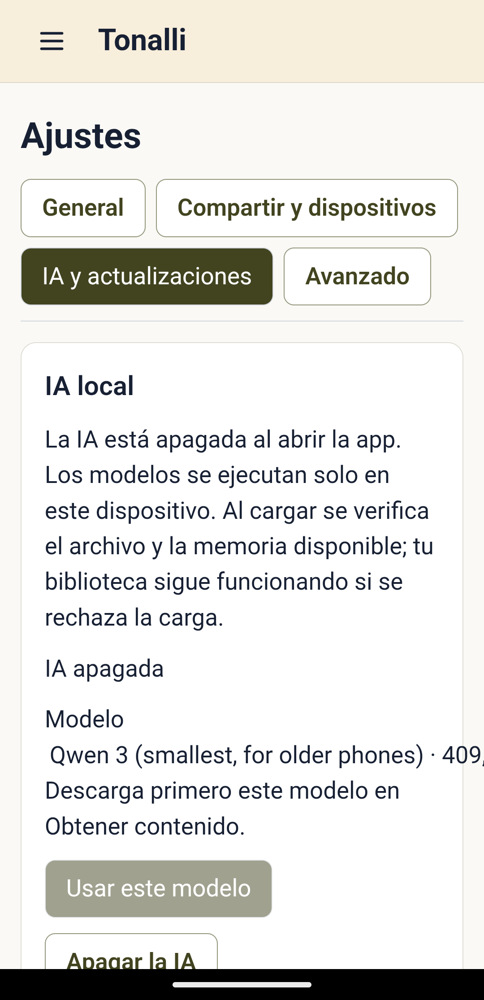
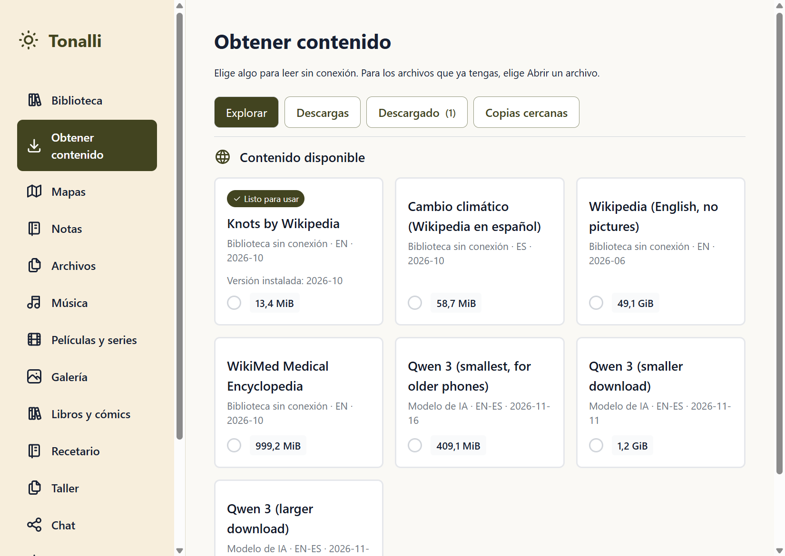
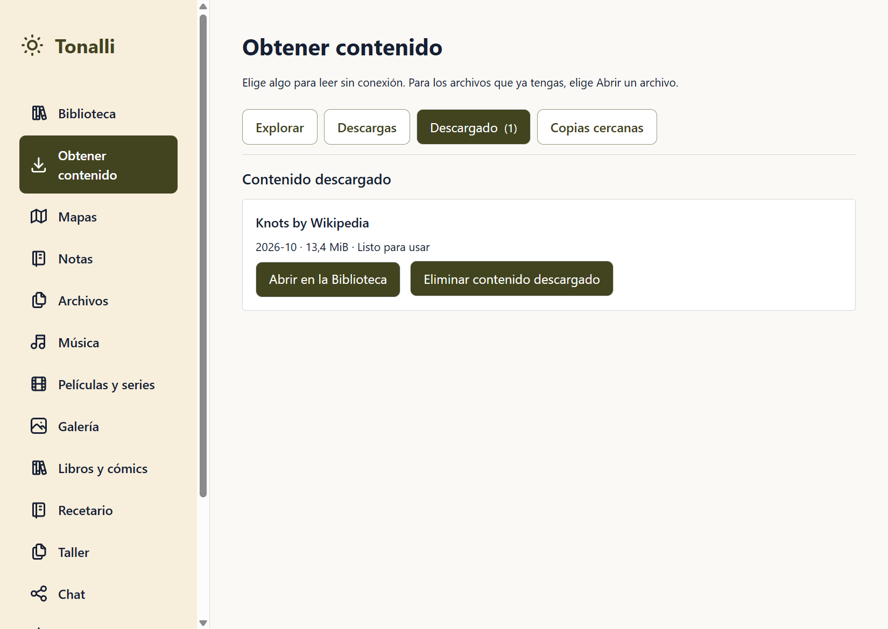
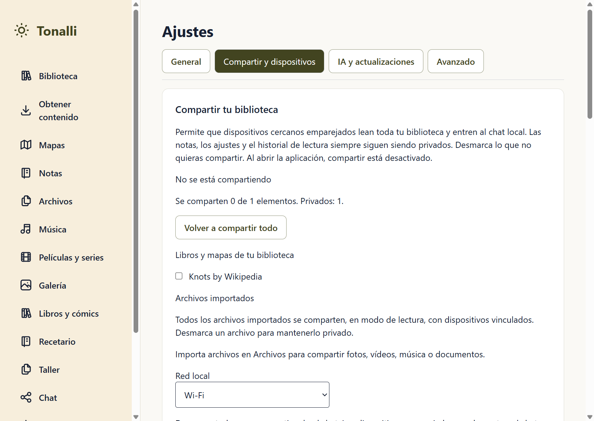
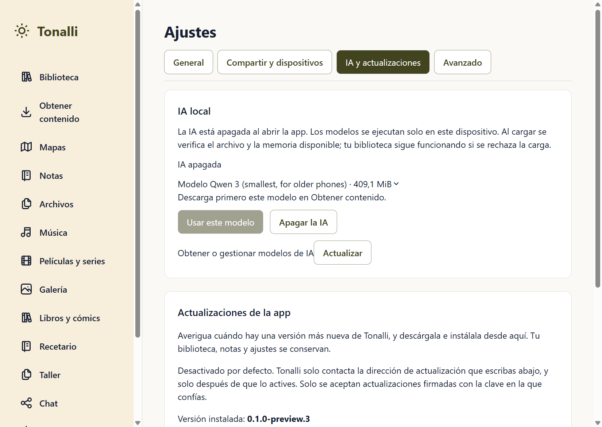
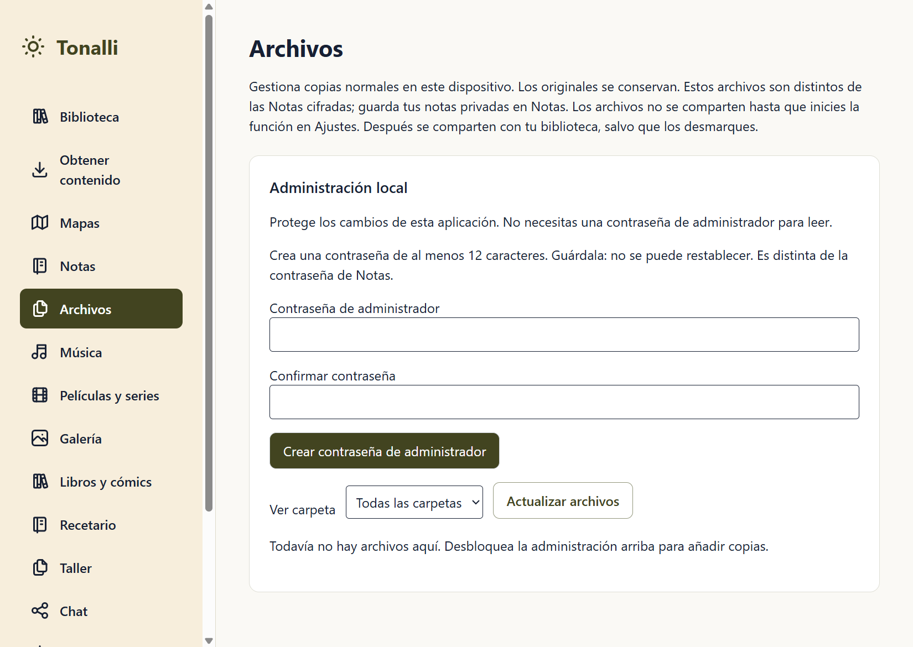

# Spanish check

The app follows the device language (English or Spanish). This section shows how the tab and
sharing screens read in Spanish.

## Android

| Get content > Descargado | Sharing |
|---|---|
|  |  |

The tab buttons wrap onto two lines, and "Compartir y dispositivos" fits. The summary reads
"Se comparten 32 de 32 elementos. Privados: 0."

| Settings > General | AI and updates |
|---|---|
|  |  |

## Windows

## Get content

| Browse | Downloaded |
|---|---|
|  |  |

Tabs: **Explorar**, **Descargas**, **Descargado (1)**, **Copias cercanas**.

## Settings and sharing

| Sharing, one item removed | AI and updates |
|---|---|
|  |  |

Tabs: **General**, **Compartir y dispositivos**, **IA y actualizaciones**, **Avanzado**.
Whole-library sharing reads "Se comparten 0 de 1 elementos. Privados: 1." with a **Volver a compartir todo**
button. The "Privados: N" wording was chosen so it reads correctly for any count.

## Files

The help text now says files are not shared until sharing is started in Ajustes, and are then shared
with the library unless unticked.

## Not translated

- Catalog entries keep their English titles in Spanish mode ("Knots by Wikipedia", "Qwen 3 (smallest,
  for older phones)"). They come from the signed content catalog, so translating them needs a new signed
  catalog revision.
